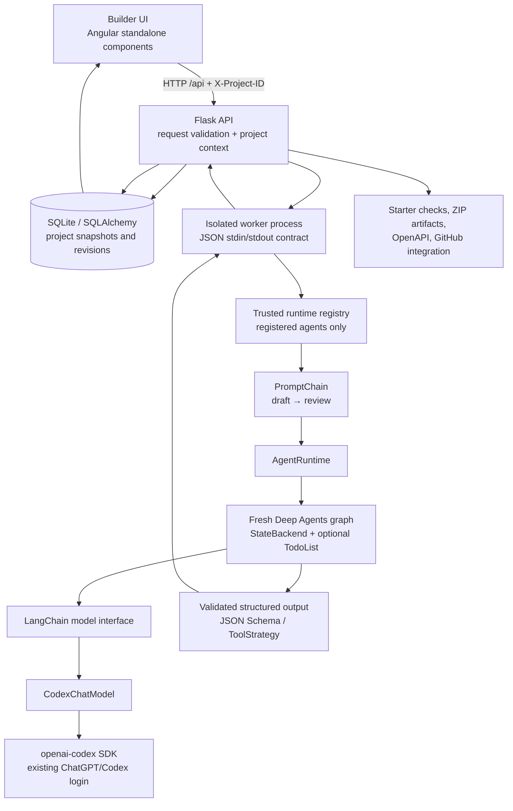

# API Builder Agent

Design an API from a guided workspace, review the generated configuration, and export a safe starter bundle—without losing the reasoning, contracts, or decisions that shaped it.

API Builder is a local-first, full-stack API design workbench. 

The agent layer uses LangChain and LangGraph-compatible Deep Agents, while the model adapter uses the user’s existing ChatGPT Codex sign-in through the official `openai-codex` SDK.

The Flask backend persists project configuration and coordinates bounded AI workflows. 

And the Angular application provides a visual way to define projects, entities, routes, authentication, access policy, search, caching, infrastructure, observability, and build artifacts. 

## A quick demo

<p><a href="https://1drv.ms/v/c/cb8c3cac74469fbc/IQCO688UzI0LQq7YokJ2XspGARNya53c8egrHBySqUNORAc?e=oECXIF">▶ Watch the API Builder demo on OneDrive</a></p>


## Why it exists

Turning an API idea into a deployable system usually means jumping between a data model, route definitions, auth policy, search design, infrastructure diagrams, tests, and documentation. API Builder keeps those decisions in one project workspace and makes the hand-offs explicit:

1. Describe the product and its entities.
2. Shape routes, access rules, search, caching, and runtime concerns.
3. Ask a narrowly scoped builder agent for a structured proposal.
4. Review and save the proposal with revision protection.
5. Run syntax, health, and runtime checks.
6. Download a starter/configuration bundle or update a GitHub repository.

## Architecture at a glance



### The important boundary

Codex supplies the model decision. LangChain provides the model contract and tool/message interface. Deep Agents owns the bounded graph and tool execution. The application runtime owns registration, configuration, timeouts, schema validation, persistence, and error handling. This separation means an agent can propose a configuration without gaining arbitrary shell access, deploying resources, or inventing credentials.

## Technology stack

| Layer | Technology | Role |
| --- | --- | --- |
| UI | Angular 21, TypeScript, standalone components, RxJS | Project workspace, forms, editors, previews, build activity, and guarded lazy routes |
| Backend | Flask 3, Flask-SQLAlchemy, SQLAlchemy | Local HTTP API, project context, persistence, revision checks, build/export orchestration |
| Agent graphs | Deep Agents, LangGraph state graphs | Fresh per-step agent graphs, bounded recursion, in-memory state, optional planning middleware |
| Agent interface | LangChain / LangChain Core | Chat-model abstraction, tool schemas, structured output, message conversion |
| Model access | `openai-codex` SDK | Uses the signed-in Codex account; no provider API key is required for the default flow |
| Contracts | JSON Schema, `ToolStrategy` | Validates agent assets, tool calls, intermediate results, and final responses |
| Data | SQLite by default | Stores local project configuration, definitions, revisions, activities, and generated artifacts |
| Observability | OpenTelemetry SDK and OTLP HTTP exporter | Optional local tracing configuration and build/runtime telemetry |

## Agent workflow

Each registered agent is intentionally small: `agent.py` contains inline prompt steps and `create_workflow()`, while `output-schema.py` defines the machine-readable response contract.

```python
def create_workflow() -> PromptChain:
    return PromptChain(draft_definition, review_definition)


def draft_definition(context, previous, runtime):
    return runtime.run("Return a complete EntityDefinition...", context)
```

At runtime, the shared layers do the rest:

- `runtime/registry.py` loads only explicitly registered agents.
- `workflows/PromptChain` passes the original request and the previous result to each step.
- `AgentBuilder` creates a fresh Deep Agents graph with isolated `StateBackend` state.
- `AgentRuntime` invokes the graph and validates the structured response once.
- `CodexChatModel` adapts Codex’s structured envelope into LangChain messages and tool calls.
- The Flask worker returns JSON or a safe, non-sensitive failure message.

### Registered builders

| Builder | Produces | Review boundary |
| --- | --- | --- |
| `entity-builder` | Attributes and directed relationships | Existing entity IDs only; schema-approved types and cardinalities |
| `search-builder` | Embedding, semantic, lexical, or hybrid search proposal | Route, source fields, ranking, chunking, filters, and unresolved requirements |
| `rbac-builder` | Roles, explicit grants, allow/deny cases | Supplied routes only; no public-route grants or wildcard access |
| `infrastructure-builder` | AWS serverless recommendation | Proposed resources only; no deployment or invented IDs/costs |
| `api-implementation-builder` | Reviewed service and validation source | Existing source structure, tests, telemetry, and requested entity behavior |

## Product features

### Project workspace

- Create and switch between isolated projects.
- Keep project name, summary, revision, activities, and generated documents together.
- Use temporary local visitor ownership for separate browser workspaces; this is identification, not authentication.
- Edit, archive, test, build, download, and optionally update a GitHub repository.

### Entities and data model

- Maintain a project-scoped entity catalog.
- Generate reviewed attributes and outgoing relationships from an entity request.
- Preview schema details, nullable fields, supported types, and relationship cardinality.
- Preserve prior definitions when generation fails or a revision is stale.
- Treat entities as metadata used to design an API; generation does not dynamically create SQL tables.

### Routing and API design

- Define CRUD-style operations and custom route intents.
- Choose public or authenticated access.
- Keep method/path/entity relationships explicit and validate duplicate or reserved paths.
- Generate local OpenAPI/Swagger references for the starter endpoint.

### Authentication and authorization

- Draft provider settings such as OAuth 2.0, OpenID Connect, Auth0, or AWS Cognito.
- Build an explicit RBAC matrix from saved routes.
- Preview allow/deny outcomes before saving.
- Export configuration, Cedar policy, CloudFormation, schema, and integration guidance.

Configuration and export are not live enforcement. A generated authorizer still needs to be attached to the deployed API, and backend bypass paths must be prevented separately.

### Search and caching

- Propose embedding/indexing routes, semantic vector search, lexical keyword search, or hybrid RRF ranking.
- Describe source fields, chunking, filters, bounded result sets, and unresolved store/model requirements.
- Configure public GET caching as route, Redis, or API Gateway policy.
- Validate that API Gateway response caching uses REST API semantics; the default HTTP API path is not treated as cached by assumption.

### Infrastructure and delivery

- Plan a minimal AWS serverless shape: CloudFront/private S3, API Gateway HTTP API, Cognito JWT, entity-prefixed Lambdas, DynamoDB on-demand, least-privilege IAM, and logs/alarms.
- Select SQS, SNS, or Redis only when the requirement justifies them.
- Run starter syntax, health, and runtime checks before archiving a build.
- Preserve unrelated files when updating an existing initialized GitHub repository; branch protection or network failures remain visible to the operator.

### Documents, observability, and load testing

- Generate and edit Markdown project documents from saved project context.
- Configure local OpenTelemetry tracing and run an observability test.
- Inspect build and agent activity logs.
- Run load tests and review requests, failures, latency percentiles, and throughput.

## Repository map

```text
api-builder-agent/
├── api-builder-ui/             # Angular workspace and project screens
├── api-builder-backend/        # Flask routes, models, validation, workers
├── builder-agents/             # Agent prompts, schemas, and shared utilities
├── runtime/                    # Registry, Codex model adapter, worker runner
├── workflows/                  # PromptChain composition
├── builder-resources/          # Reusable serverless starter generator
├── instance/                   # Default local SQLite database location
├── .codex/config/agents/       # Optional trusted agent settings
└── requirements*.txt           # Python runtime and development dependencies
```

## Quick start

### Prerequisites

- Python 3.11+ (the current development environment also supports 3.14).
- Node.js/npm compatible with the Angular workspace.
- A local Codex sign-in for model-backed generation.

### Install

From the repository root:

```bash
python3 -m venv .venv
.venv/bin/pip install -r requirements-dev.txt

cd api-builder-ui
npm install
cd ..

codex login status
```

If needed, run `codex login` privately in your terminal. Do not commit credentials or paste tokens into issues, prompts, or this repository.

### Run the backend and UI

Terminal 1:

```bash
.venv/bin/python api-builder-backend/app.py
```

The backend listens on `http://127.0.0.1:5000` and initializes the default SQLite database at `instance/entities.db`.

Terminal 2:

```bash
cd api-builder-ui
npm start
```

The Angular dev server uses its proxy configuration to forward `/api` requests to the backend. Open the URL printed by Angular and start at **Projects**.

### A small API example

```bash
curl -X POST http://127.0.0.1:5000/api/projects \
  -H 'Content-Type: application/json' \
  -d '{"name":"Orders API","summary":"A small order management service"}'

curl http://127.0.0.1:5000/api/health
```

For a model-backed entity generation example, see [`api-builder-backend/README.md`](api-builder-backend/README.md). It includes the legacy entity-definition endpoints, environment variables, error behavior, and the opt-in live smoke check.

## Verification

Run the checks from the repository root:

```bash
.venv/bin/python -m pytest -q api-builder-backend/tests
python3 -m unittest discover -s builder-resources -p 'test_*.py'

cd api-builder-ui
npm run build
npm test
```

The live Codex smoke test makes a real model call and is intentionally separate from the mocked/unit workflow checks:

```bash
.venv/bin/python api-builder-backend/live_smoke.py
```

## Configuration

Common settings are environment-driven and have safe local defaults:

| Variable | Purpose |
| --- | --- |
| `DATABASE_URL` | SQLAlchemy database URL; defaults to local SQLite |
| `CODEX_HOME` | Codex configuration/login directory |
| `ENTITY_AGENT_MODEL` | Optional model override for entity generation |
| `ENTITY_AGENT_TIMEOUT` | Whole-worker deadline for entity generation |
| `ENTITY_AGENT_RECURSION_LIMIT` | Per-graph recursion bound |
| `SEARCH_AGENT_*`, `RBAC_AGENT_*`, `INFRASTRUCTURE_AGENT_*` | Matching settings for each registered builder |
| `PORT` | Backend bind port when running the Flask app directly |

Settings precedence is defaults, optional JSON settings, environment, then programmatic overrides. `.env` files are not loaded automatically.

## Safety and current limitations

- Agents receive only the tools and context injected by the application.
- The Codex adapter runs with a read-only, deny-all approval, ephemeral workspace.
- Agent outputs are schema-validated before application code uses them.
- Timeouts terminate the worker process group and preserve the previous saved proposal where possible.
- Generated infrastructure is a reviewable plan, not a deployment.
- GitHub credentials are accepted only for the repository operation and are not persisted as project configuration.
- The anonymous visitor cookie is temporary identification, not account authentication or cross-device identity.
- Local project settings should not be treated as production tenant authorization.

## Contributing

Keep new agents focused and contract-driven:

1. Add `agent.py` and `output-schema.py` under `builder-agents/<name>/`.
2. Register the agent in `runtime/registry.py`.
3. Compose steps with `workflows/PromptChain` and reuse `shared/AgentBuilder` through `AgentRuntime`.
4. Add or update backend/UI tests and keep prompts inline with the function that uses them.
5. Run the build and test commands above, then record the actual checks and any blockers in `.codex/docs/tasks/<task>/summary.md`.
