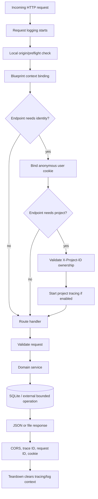
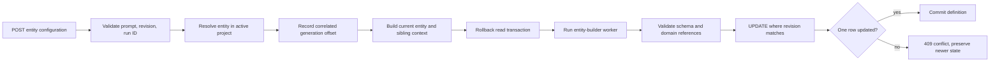

# API Builder backend architecture and implementation guide

[`api-builder-backend/`](../api-builder-backend/) is a Flask application that owns HTTP validation, anonymous local workspace ownership, SQLite persistence, project configuration, agent invocation, artifact generation, operational logging, and tracing. It treats agent output as a proposal until the relevant service validates domain invariants and, where applicable, commits it with optimistic revision checks.

Related guides:

- [Runtime architecture](runtime.md) explains the isolated agent process and model adapter.
- [Builder agents](builder-agents.md) explains every structured-output agent and shared module.

## Directory structure

```text
api-builder-backend/
├── app.py                         Flask application factory and error handlers.
├── routing.py                     Blueprint, request context, and HTTP handlers.
├── models.py                      SQLAlchemy metadata and project snapshots.
├── validation.py                  Request schemas and cross-field validation.
├── live_smoke.py                  Live smoke support.
├── services/
│   ├── caching_service.py         Cache policy persistence and exports.
│   ├── configuration_service.py   Entity definitions and endpoint snapshots.
│   ├── document_service.py        Generated/editable Markdown documents.
│   ├── entity_service.py          Legacy entity generation flow.
│   ├── generation_logs_service.py Incremental safe generation logs.
│   ├── github_service.py          Tested artifact publication through GitHub REST.
│   ├── load_testing_service.py    Docker/Locust workload execution and reports.
│   ├── local_connection_service.py Local-origin and CORS boundary.
│   ├── logger_service.py          Backend import bridge to shared logging.
│   ├── observability_service.py   Revisioned tracing configuration.
│   ├── project_build_service.py   Render, implement, test, package, and run builds.
│   ├── project_service.py         Project migration and ownership checks.
│   ├── rbac_service.py            RBAC generation, preview, and deterministic export.
│   └── user_service.py            Anonymous user cookie lifecycle.
└── tests/                          API, service, agent, and workflow tests.
```

Generated artifacts and the default database are outside this folder at the repository-level `generated-artifacts/` and `instance/` paths.

## Application startup

[`app.py`](../api-builder-backend/app.py) exposes `create_app(config=None)`, which is used by development, tests, and generated checks.

Startup order matters:

1. Configure payload-free application logging.
2. Create Flask with the repository-level `instance/` directory.
3. Load database, content-size, and per-agent timeout settings.
4. Apply explicit test/caller configuration overrides.
5. Install request logging and OpenTelemetry hooks.
6. Initialize SQLAlchemy.
7. Install the local-origin request boundary.
8. Register the same blueprint at both `/` and `/api`.
9. Register JSON error handlers.
10. Create tables and migrate/initialize projects.

Because the blueprint is registered twice, every route listed below is available at both forms, for example `/health` and `/api/health`. The Angular development proxy uses the `/api` form.

Default configuration includes:

| Setting | Default |
| --- | --- |
| `SQLALCHEMY_DATABASE_URI` | `sqlite:///entities.db` |
| `MAX_CONTENT_LENGTH` | 65,536 bytes |
| `ENTITY_AGENT_TIMEOUT` | 120 seconds |
| `RBAC_AGENT_TIMEOUT` | 120 seconds |
| `SEARCH_AGENT_TIMEOUT` | 180 seconds |
| `INFRASTRUCTURE_AGENT_TIMEOUT` | 180 seconds |

`DATABASE_URL`, `PORT`, and the timeout environment variables can override these defaults. The explicit Build path also reads `IMPLEMENTATION_AGENT_TIMEOUT`, defaulting to 300 seconds.

## Request lifecycle



### Anonymous identity and project ownership

This is local workspace separation, not authentication.

- `user_service.bind_user()` reuses the `user_id` cookie or creates a random `user-1000`–`user-9999` identity and a Default project.
- `save_user_cookie()` stores the identity and prevents caching another user's catalog.
- `project_service.require_project()` reads `X-Project-ID` and rejects missing, archived, or other-user projects.
- `routing.bind_project_context()` explicitly lists handlers requiring user and project context.

### Local browser boundary

`local_connection_service` accepts same-origin requests and credentialed loopback browser origins only when scheme and hostname match the backend. It constrains methods and request headers for preflight requests. It does not expose the backend to arbitrary remote origins.

## Data model

[`models.py`](../api-builder-backend/models.py) contains two generations of entity storage plus project-scoped configuration.

### Legacy entity models

| Model | Responsibility |
| --- | --- |
| `EntityName` | Legacy ID/name catalog used during project migration. |
| `Entity` | Legacy generated entity definition with a revision counter. |
| `EntityAttribute` | Legacy attributes owned by `Entity`. |
| `EntityRelationship` | Legacy outgoing relationships owned by `Entity`. |
| `RbacConfiguration` | Legacy singleton RBAC snapshot. |

The legacy `/create-entity`, `/generate-entity-attributes`, and `/entities/<id>` handlers still operate on these models.

### Ownership and project models

| Model | Responsibility |
| --- | --- |
| `User` | Anonymous local identity; password/email fields are unused placeholders. |
| `Project` | User-owned named workspace. |
| `ProjectArchive` | Recoverable project removal marker. |
| `ProjectEntityName` | Project-scoped entity catalog. |

### Revisioned project configuration

| Model | Stored data |
| --- | --- |
| `ProjectEntityDefinition` | Prompt plus generated attributes/relationships per entity. |
| `ProjectEndpoints` | Complete endpoint catalog. |
| `ProjectRbacConfiguration` | RBAC identity/routes/roles/grants snapshot. |
| `ProjectCachingConfiguration` | Selected cache policy. |
| `ProjectObservabilityConfiguration` | OTLP tracing policy. |
| `ProjectDocument` | User-edited generated Markdown by slug. |

### Build and publication state

| Model | Stored data |
| --- | --- |
| `ProjectBuild` | Tested ZIP, filename, and source/configuration fingerprint. |
| `ProjectRepository` | GitHub owner/name/URL only; never the token. |

Most configuration tables use a revision integer. Services update with `WHERE revision = <client revision>` and require exactly one changed row, preventing one editor or long-running generation from overwriting newer state.

## HTTP API

All paths also exist beneath `/api`.

### Health, projects, and observability

| Method and path | Handler | Behavior |
| --- | --- | --- |
| `GET /health` | `health` | Database readiness check without creating an anonymous workspace. |
| `GET /projects` | `projects` | Lists active projects for the current anonymous user. |
| `POST /projects` | `projects` | Creates a validated project. |
| `PUT /projects/<project_id>` | `project_details` | Updates project name and summary. |
| `DELETE /projects/<project_id>` | `project_details` | Archives the project without deleting configuration. |
| `GET /observability` | `observability` | Reads project tracing defaults or saved policy. |
| `PUT /observability` | `observability` | Revision-checks and saves local OTLP settings. |
| `POST /observability/test` | `observability_test` | Sends a real always-sampled test span to the saved collector. |

### Entity and endpoint configuration

| Method and path | Handler | Behavior |
| --- | --- | --- |
| `GET /entities` | `entity_names` | Lists project entity names. |
| `POST /entities` | `entity_names` | Adds a project entity and deterministic default endpoints. |
| `PUT /entities/<entity_id>` | `entity_name_details` | Renames an owned entity and endpoint references. |
| `DELETE /entities/<entity_id>` | `entity_name_details` | Removes owned entity configuration and dependent routes. |
| `GET /entity-configurations/<entity_id>` | `entity_configuration` | Reads saved or empty schema state. |
| `POST /entity-configurations/<entity_id>` | `entity_configuration` | Runs `entity-builder` and persists validated output. |
| `PUT /entity-configurations/<entity_id>` | `entity_configuration` | Saves reviewed attribute edits without model generation. |
| `GET /entity-configurations/<entity_id>/logs/<run_id>` | `entity_generation_logs` | Pages safe correlated generation events. |
| `GET /endpoints` | `endpoint_configuration` | Reads saved routes or deterministic defaults. |
| `PUT /endpoints` | `endpoint_configuration` | Validates and revision-checks the complete route snapshot. |

### Proposals and policy configuration

| Method and path | Handler | Behavior |
| --- | --- | --- |
| `POST /generate-search-configuration` | `generate_search_configuration` | Runs `search-builder`; does not provision or save a search backend. |
| `POST /generate-infrastructure-plan` | `generate_infrastructure_plan` | Runs `infrastructure-builder`; does not create AWS resources. |
| `GET /rbac` | `rbac` | Reads the saved project RBAC snapshot. |
| `PUT /rbac` | `rbac` | Saves a validated RBAC configuration. |
| `POST /rbac/generate` | `rbac` | Runs `rbac-builder` and returns an unsaved proposal. |
| `POST /rbac/preview` | `rbac` | Evaluates the local explicit grant matrix. |
| `POST /rbac/export` | `rbac` | Exports deterministic artifacts from the exact saved revision. |
| `GET /caching` | `caching` | Reads the project cache policy and presets. |
| `PUT /caching` | `caching` | Saves a validated revisioned cache policy. |
| `POST /caching/export` | `caching` | Exports templates for the exact saved revision. |

### Documents, builds, publication, and load testing

| Method and path | Handler | Behavior |
| --- | --- | --- |
| `GET /project-documents` | `project_documents` | Lists generated/editable project documents. |
| `GET /project-documents/<slug>` | `project_documents` | Reads one generated or edited document. |
| `PUT /project-documents/<slug>` | `project_documents` | Saves a revision-checked edit. |
| `GET /projects/<id>/openapi` | `project_action` | Returns OpenAPI for executable configured routes. |
| `POST /projects/<id>/test` | `project_action` | Renders and tests trusted starter source without implementing agent code. |
| `POST /projects/<id>/build` | `project_action` | Runs the implementation agent, tests in Docker, and stores a ZIP. |
| `GET /projects/<id>/download` | `project_action` | Downloads only a current fingerprint-matching build. |
| `POST /projects/<id>/run` | `project_action` | Starts the current tested build at `127.0.0.1:8080`. |
| `POST /projects/<id>/github` | `project_action` | Publishes the tested ZIP through GitHub REST. |
| `GET /projects/<id>/build/logs/<run_id>` | `project_build_logs` | Pages safe build events. |
| `GET /load-testing` | `load_testing` | Reads the latest project load-test state/report. |
| `POST /load-testing` | `load_testing` | Starts a bounded Docker/Locust run asynchronously. |

### Legacy endpoints

| Method and path | Handler | Behavior |
| --- | --- | --- |
| `POST /create-entity` | `create_entity` | Creates a legacy `Entity`. |
| `POST /generate-entity-attributes` | `generate_attributes` | Runs entity generation against legacy tables. |
| `GET /entities/<entity_id>` | `get_entity` | Reads a legacy generated entity definition. |

These overlap path shapes with the project-scoped catalog but have different method combinations and storage. New UI work should use `/entities` plus `/entity-configurations/<id>`.

## Service layer

Routes own HTTP translation; services own domain behavior and side effects.

| Service | Main responsibility |
| --- | --- |
| `configuration_service` | Project entity ownership, generation context, schema persistence, default routes, endpoint revisions. |
| `project_build_service` | Deterministic source rendering, fingerprints, implementation generation, tests, ZIP persistence, local run, OpenAPI. |
| `rbac_service` | RBAC revisions, agent generation, local preview, deterministic CloudFormation/Cedar export. |
| `caching_service` | Cache revisions, presets, and deterministic template export. |
| `document_service` | Generated documentation overlay and revision-checked user edits. |
| `observability_service` | Per-project tracing defaults and optimistic updates. |
| `load_testing_service` | Validate scenarios, prepare Locust code, run isolated Docker workloads, parse reports. |
| `github_service` | Create/select repositories and append a non-force commit without persisting credentials. |
| `generation_logs_service` | Correlate a run with the shared log and expose only safe incremental fields. |
| `project_service` | Legacy ownership migration and active project validation. |
| `user_service` | Anonymous user allocation and cookie persistence. |
| `local_connection_service` | Loopback origin checks and credentialed CORS headers. |
| `entity_service` | Legacy entity worker and atomic attribute/relationship replacement. |
| `logger_service` | Stable backend import surface for shared logging. |

## Validation approach

[`validation.py`](../api-builder-backend/validation.py) centralizes structural and cross-field validation. JSON Schema handles bounded shapes and allowed values; Python checks relationships that schemas cannot express cleanly.

Examples:

- project names/summaries are stripped and bounded;
- entity names are non-empty and at most 100 characters;
- endpoint paths are shape-checked, unique after `{id}` normalization, and tied to valid entity/operation/method combinations;
- RBAC grants reference existing roles and canonical routes and cannot target public routes;
- API Gateway response caching is rejected for HTTP API configurations;
- OTLP endpoints must be loopback HTTP `/v1/traces` URLs with valid ports;
- sampling ratios must be finite and within 0–1.

A route validates once, then downstream services assume that contract. Domain services add ownership, revision, and agent-output invariants before persistence.

## Key implementation flows

### Entity generation



The read transaction is released before the long model call. After generation, the service rechecks entity ownership and atomically increments the expected revision. This prevents stale model output from replacing newer user edits.

Core pattern:

```python
result = db.session.execute(
    update(ProjectEntityDefinition)
    .where(
        ProjectEntityDefinition.entity_id == entity_id,
        ProjectEntityDefinition.revision == payload["revision"],
    )
    .values(
        revision=payload["revision"] + 1,
        prompt=payload["prompt"],
        document=definition,
    )
)

if result.rowcount != 1:
    raise Conflict("Entity changed during generation. Reload and retry.")
```

### Project test and Build

`project_build_service` keeps testing and implementation distinct:

1. `build_files()` renders trusted template source, configuration snapshots, docs, OpenAPI, logging, and telemetry.
2. `fingerprint()` hashes every rendered file in deterministic key order.
3. Test checks compile Python, parse JSON, require entity attributes, and reject unsupported endpoint operations.
4. Build additionally calls `api-implementation-builder` for only `record_service.py` and `validation.py`.
5. Agent-written source is built and tested inside a disposable locked-down Docker container.
6. The service re-renders source and rejects the result if configuration changed during implementation.
7. Only a successful Build stores the ZIP and source fingerprint.

Downloads, GitHub publication, and local execution all call `ready_build()`, which refuses stale artifacts when source or saved configuration no longer matches the stored fingerprint.

### RBAC generation and export

RBAC generation returns an unsaved proposal. Identity and route snapshots stay fixed while roles, grants, notes, questions, and cases are model-generated and validated. Export is deterministic Python code, not model-generated policy source: it compiles the exact saved revision into reviewable artifacts and packages them in memory.

### Generated documents

`document_service.generated_documents()` derives Markdown from persisted project configuration. `read_documents()` overlays any user edits. Generated source changes therefore do not overwrite edited content. Saves use revisions to detect stale editors.

### Load testing

The load-testing service validates host/workload bounds and explicit route scenarios before launching work. It caches generated scenario code, serializes one run per project, executes Locust in Docker, persists success and failure reports, parses CSV statistics, and cleans up the specific run container after completion or timeout.

## Logging and observability

Application logging and OpenTelemetry tracing are separate but correlated.

### Application logs

- JSON lines under repository `logs/`.
- Request, function, workflow, worker, generation, and build lifecycle events.
- Allowlisted metadata only; no request bodies, prompts, model output, credentials, or exception messages.
- `X-Request-ID` returned to the browser.
- Child workers inherit the current log file and trace context.

### OpenTelemetry

- Configuration belongs to the selected project.
- Only local OTLP/HTTP receivers are accepted.
- HTTP spans use route templates and safe method/status/resource attributes.
- No global tracer-provider mutation.
- `X-Trace-ID` returned when a request is traced.
- The test endpoint performs an actual exporter call and reports receiver acceptance.

## Error handling

The application handles expected failures at HTTP or process boundaries:

- malformed/invalid input → `400`;
- missing or inaccessible resource → `404`;
- revision or uniqueness conflict → `409`;
- agent timeout → `504`;
- unavailable generation/runtime or collector → `502`/`503` as appropriate;
- SQLAlchemy failures → rollback and generic `500`.

Provider, database, token, and internal exception details are not returned to callers. Services roll back when a route may continue after a failed transaction.

## Extending the backend

For a new project-scoped configuration feature:

1. Add or reuse a model with `project_id`, `revision`, and a bounded document shape.
2. Put structural and cross-field request validation in `validation.py`.
3. Put ownership, revision updates, persistence, generation, or export logic in a focused service.
4. Add a route that translates validated service results/errors to HTTP.
5. Add the handler name to `bind_project_context()` when user/project context is required.
6. Avoid holding a database transaction across model, network, Docker, or subprocess work.
7. Revalidate ownership and revisions before committing long-running results.
8. Add API and service tests for success, invalid input, isolation, stale revision, and external failure.

If the feature needs an agent, follow [Builder agents](builder-agents.md) and register it through the [Runtime](runtime.md). Do not execute a caller-selected module or persist unvalidated model output.

## Running and testing

Start the backend from the repository root:

```bash
.venv/bin/python api-builder-backend/app.py
```

It listens on `http://127.0.0.1:5000` by default. A quick readiness check is:

```bash
curl -sS http://127.0.0.1:5000/api/health
```

Run the backend test suite:

```bash
.venv/bin/python -m pytest api-builder-backend/tests -q
```

The suite covers projects and anonymous isolation, entities, revisions, agent workflows, response validation, search, RBAC, caching, infrastructure, documents, local connections, logging, tracing, builds, GitHub-facing actions, and load-testing behavior. Live Codex sign-in/model behavior, Docker availability, GitHub access, and a real OTLP collector are separate environment-dependent checks.
