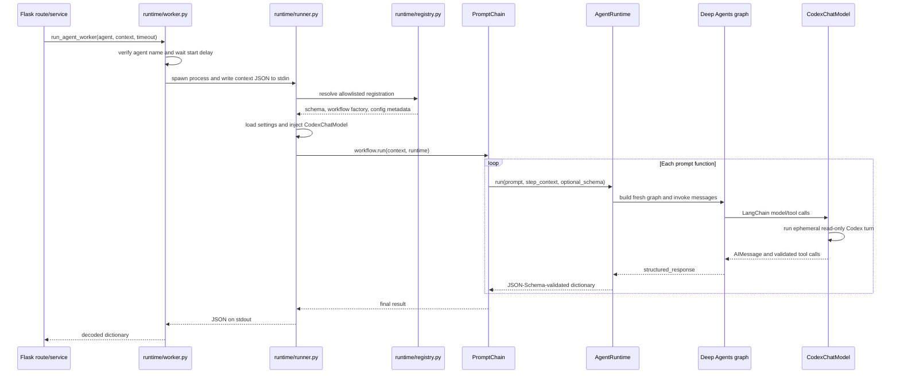

# Runtime architecture and implementation guide

The [`runtime/`](../runtime/) package is the trusted execution boundary between the Flask backend and the LangChain-based builder agents. It resolves only registered local agents, launches them in a separate process, constructs a fresh Deep Agents graph for each prompt step, adapts the signed-in Codex SDK to LangChain's chat-model interface, and returns validated JSON.

Related guides:

- [Builder agents](builder-agents.md) documents every agent and the shared construction layer.
- [API Builder backend](api-builder-backend.md) documents the HTTP and persistence layer that invokes the runtime.

## Directory structure

```text
runtime/
├── __init__.py         Package marker.
├── agent_runtime.py    Builds and invokes one graph for one prompt step.
├── codex_model.py      Adapts the Codex SDK to LangChain BaseChatModel.
├── registry.py         Allowlist of trusted agents and their local assets.
├── runner.py           JSON stdin/stdout entry point executed by workers.
└── worker.py           Backend-facing subprocess lifecycle and timeout boundary.

workflows/
└── prompt_chain.py     Orders agent-owned prompt functions.
```

The runtime imports shared construction and validation code from [`builder-agents/shared/`](../builder-agents/shared/). `runner.py` adds the project root to `sys.path`; loading the `runtime` package then adds `builder-agents/` through `runtime/__init__.py`. Together these make `runtime`, `workflows`, and the top-level `shared` package available when a worker starts from an arbitrary directory.

## End-to-end execution flow



There are two independent bounds:

1. `runtime/worker.py` owns the wall-clock subprocess timeout and process-group cleanup.
2. `AgentBuilder` applies the graph recursion limit from `AgentSettings`.

A recursion limit constrains graph steps; it is not a replacement for the worker timeout.

## Component responsibilities

### Registry: trusted agent allowlist

[`runtime/registry.py`](../runtime/registry.py) defines `AgentRegistration` and the `AGENTS` dictionary. Registration is explicit; request data cannot provide a module path or dynamically import arbitrary code.

Each registration contains:

- the trusted directory containing `agent.py` and `output-schema.py`;
- an optional JSON deployment settings file;
- an environment-variable prefix.

The loader uses `runpy.run_path()` because agent directories and `output-schema.py` use hyphenated names that are not normal Python import names:

```python
@dataclass(frozen=True)
class AgentRegistration:
    directory: Path
    config_path: Path | None = None
    env_prefix: str = "AGENT"

    def load_schema(self) -> dict:
        return run_path(str(self.directory / "output-schema.py"))["OUTPUT_SCHEMA"]

    def create_workflow(self) -> object:
        module = run_path(str(self.directory / "agent.py"))
        return module["create_workflow"]()
```

Importing these files must remain side-effect free: `agent.py` defines prompt functions and a workflow factory, while model execution happens only after `workflow.run(...)`.

### Worker: backend-facing process isolation

[`runtime/worker.py`](../runtime/worker.py) exposes `run_agent_worker(agent, context, timeout)`.

Its current behavior is:

1. Reject names not present in `AGENTS`.
2. Wait `WORKFLOW_START_DELAY_SECONDS` (currently 30 seconds).
3. Spawn `runtime/runner.py` in a new process session.
4. Send the context as JSON through stdin.
5. Wait up to the supplied timeout for process completion.
6. Kill the whole process group on timeout.
7. Return decoded stdout only when the child exits successfully.

The worker passes a sanitized, correlated environment from `shared.logging_service.worker_environment()`. Provider details and stderr are not returned to HTTP clients; failures become a stable `RuntimeError` at this boundary.

### Runner: composition root

[`runtime/runner.py`](../runtime/runner.py) is the executable composition root. It is intentionally the only place that assembles the default CLI stack:

```python
registration = AGENTS[args.agent]
settings = load_agent_settings(
    registration.config_path,
    env_prefix=registration.env_prefix,
)
builder = AgentBuilder(CodexChatModel(model_name=settings.model_name))
runtime = AgentRuntime(builder, settings, registration.load_schema())
workflow = registration.create_workflow()
result = workflow.run(json.load(sys.stdin), runtime)
```

Successful execution writes exactly one JSON document to stdout. Expected configuration, schema, graph, SDK, and operating-system failures are caught at the entry point, logged without payloads, and represented by a generic stderr message plus exit code `1`.

### PromptChain: deterministic workflow ordering

[`workflows/prompt_chain.py`](../workflows/prompt_chain.py) is a small orchestration layer, not another agent loop. It calls prompt functions in order and passes each function:

- a deep copy of the original request context;
- a deep copy of the previous step's result (`None` for the first step);
- the injected `AgentRuntime`.

```python
for step in self.steps:
    with LogStep("workflow.step", step=step.__name__):
        result = step(deepcopy(context), deepcopy(result), runtime)
```

An exception stops the chain. There is no implicit retry, branching, persistence, or review loop. Those behaviors must be implemented explicitly and bounded if a future workflow needs them.

### AgentRuntime: one prompt, one fresh graph

[`runtime/agent_runtime.py`](../runtime/agent_runtime.py) binds three dependencies:

- `AgentBuilder`, which knows how to construct a graph;
- immutable `AgentSettings`;
- the agent's default output schema.

For each prompt step, `run()` builds a new graph, serializes the supplied context into one user message, invokes the graph, then validates `structured_response` once:

```python
output_schema = self.output_schema if schema is None else schema
graph = self.builder.build(self.settings, prompt, output_schema)
result = graph.invoke({
    "messages": [{"role": "user", "content": json.dumps(context)}]
})
return validate_agent_response(result.get("structured_response"), output_schema)
```

The optional `schema` parameter lets a step narrow or change an intermediate contract. The search agent uses this to constrain `ranking` and `embedding` according to the requested search type.

### CodexChatModel: LangChain adapter

[`runtime/codex_model.py`](../runtime/codex_model.py) implements the required `BaseChatModel` interface:

- `bind_tools()` converts LangChain tools to OpenAI-compatible function schemas;
- `_generate()` performs one Codex turn and creates a LangChain `AIMessage`;
- `_llm_type` identifies the adapter to callbacks;
- `get_num_tokens_from_messages()` provides a conservative local estimate.

`run_codex_turn()` creates a temporary workspace and starts an ephemeral Codex thread with these controls:

- forces the existing ChatGPT/Codex sign-in method;
- removes `OPENAI_API_KEY` and `CODEX_API_KEY` from the child environment;
- uses `Sandbox.read_only` and `ApprovalMode.deny_all`;
- instructs Codex to request only harness tools and never native tools;
- validates the model response against a fixed envelope schema.

The envelope separates assistant text from requested tool calls:

```json
{
  "content": "",
  "tool_calls": [
    {
      "name": "EntityDefinition",
      "arguments_json": "{\"entity_id\": 12, ...}"
    }
  ]
}
```

Before a call reaches LangChain, the adapter verifies that the tool exists, parses its JSON arguments, validates those arguments against the bound tool schema, assigns a new call ID, and enforces `tool_choice`. Deep Agents—not Codex itself—owns tool execution.

## Configuration precedence

`shared.configuration.load_agent_settings()` applies settings in this order:

```text
AgentSettings defaults
    < optional JSON file
    < environment variables
    < explicit Python overrides
```

Supported environment variables are:

- `<PREFIX>_CONFIG`: alternate JSON settings path;
- `<PREFIX>_MODEL`: model name, with blank mapped to `None`;
- `<PREFIX>_RECURSION_LIMIT`: integer graph recursion limit.

Settings reject unknown fields and are immutable after validation. `planning` enables `TodoListMiddleware`; `tools` names must resolve through the injected trusted tool registry. The default runner does not inject application tools.

## Failure and safety boundaries

| Boundary | Protection |
| --- | --- |
| Agent selection | Name must exist in `runtime.registry.AGENTS`. |
| Code loading | Registry supplies trusted local paths; request data cannot choose imports. |
| Process execution | Separate process session, bounded communication timeout, process-group kill. |
| Model workspace | Temporary directory, read-only sandbox, denied approvals, ephemeral thread. |
| Credentials | Existing ChatGPT sign-in is forced; API-key variables are removed. |
| Tool calls | Known tool name, JSON parsing, argument schema, and `tool_choice` are enforced. |
| Structured output | Deep Agents `ToolStrategy` plus final JSON Schema validation. |
| State | A fresh graph and `StateBackend` are created for every prompt step. |
| Logs | Payload-free allowlisted fields with inherited trace correlation. |

`StateBackend` isolates graph scratch state but is not an operating-system sandbox. The separate Codex sandbox and process controls provide the external execution boundary.

## Running an agent directly

From the repository root, provide one context object on stdin:

```bash
printf '%s\n' '{"entity_id":1,"description":"An order","prompt":"Add status and total","entity":{"id":1,"name":"Order","revision":0,"attributes":[],"relationships":[]},"existing_entities":[{"id":1,"name":"Order"}]}' \
  | .venv/bin/python runtime/runner.py entity-builder
```

This is a live model call and requires a valid local Codex sign-in. Automated tests mock the external SDK boundary while exercising the real runtime composition.

## Adding or extending an agent

1. Create `builder-agents/<name>/agent.py` with inline prompt functions and `create_workflow()`.
2. Create `builder-agents/<name>/output-schema.py` with an object `OUTPUT_SCHEMA` containing a non-empty `title` and `description`.
3. Register the trusted directory in `runtime/registry.py`.
4. Add an optional settings file under `.codex/config/agents/` only when defaults are insufficient.
5. Add workflow, configuration, structured-output, and failure-path tests.

Minimal workflow:

```python
from runtime.agent_runtime import AgentRuntime
from workflows.prompt_chain import PromptChain


def draft(context: dict, previous: dict | None, runtime: AgentRuntime) -> dict:
    """Draft the requested structured result."""
    return runtime.run("Return Summary only.", context)


def create_workflow() -> PromptChain:
    """Create the agent's ordered prompt workflow."""
    return PromptChain(draft)
```

Do not add auto-discovery, arbitrary import paths, prompt files, per-agent utility copies, or duplicate response validation. Shared construction and validation belong in `builder-agents/shared/`.

## Verification

The focused runtime and workflow coverage lives primarily in:

- [`test_agent_configuration.py`](../api-builder-backend/tests/test_agent_configuration.py)
- [`test_agent_response_validation.py`](../api-builder-backend/tests/test_agent_response_validation.py)
- [`test_agent_workflows.py`](../api-builder-backend/tests/test_agent_workflows.py)

Run the backend suite from the repository root:

```bash
.venv/bin/python -m pytest api-builder-backend/tests -q
```

The tests verify configuration precedence and rejection, fresh graph construction, tool-call translation, structured-output failures, workflow order and isolation, dependency injection, and runner dispatch. They do not prove current live-model latency or sign-in state.
